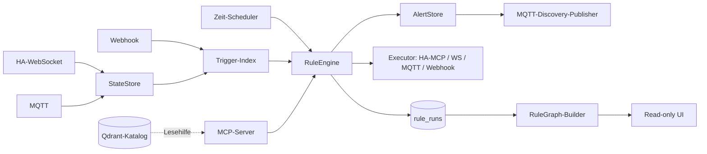

# Architektur smart-bridge

Die Bridge läuft neben Home Assistant (HA). Sie ist im Betrieb HA-unabhängig, nutzt HA aber für Geräte und Integrationen.

## Grundsätze

- Quellen und Senken sind Adapter hinter klaren Interfaces (`Protocol`).
- Die RuleEngine kennt kein HA und kein Netzwerk. Zeit (`Clock`) und Zustand (`StateStore`) sind injiziert.
- YAML in `config/rules/*.yaml` ist die Single Source of Truth. Vektorindex und UI sind abgeleitet.
- Der Katalog ist eine reine Lesehilfe. Regelauswertung und Aktionen hängen nie davon ab.
- HA-Ausfall: Reconnect mit Backoff, letzter Zustand bleibt gültig, Entities werden `stale`. Stale-Wechsel sind keine Zustandsänderung.
- Zeitlogik nur mit tz-aware Datetimes (Standard `Europe/Berlin`).

## Modulstruktur (`src/smart_bridge/`)

| Modul | Aufgabe | Meilenstein |
|---|---|---|
| `settings` | Env-/Secret-Konfiguration | M1 |
| `rules` | Pydantic-Modell, Loader, JSON Schema | M1 |
| `cli` | `bridge validate` | M1 |
| `api` | FastAPI (`/healthz`, `/readyz`, ...) | M1 |
| `state` | StateStore, `stale`-Handling | M2 |
| `adapters` | HA-WS, MQTT | M2 |
| `engine` | Conditions, `for`, `active`, Trigger-Index | M3 |
| `scheduler` | time/cron/date/sun, Missed-Fire | M4 ✔ |
| `alerts` | AlertStore, Discovery-Publisher, Ziel-Handshake | M5 ✔ |
| `executor` | MCP, WS, MQTT, Webhook, `rule_runs` | M6 ✔ |
| `mock_ha` | Mock-HA (WS + MCP) für Dev/Tests | M6 ✔ |
| `catalog` | Registry-Sync, Embeddings, Qdrant, `state_history` | M8 ✔ |
| `mcp_server`, `simulate`, `audit` | Claude-Schnittstelle (lesend M9 ✔, Schreiben M10) | M9/M10 |
| `graph`, `ui_api` | RuleGraph, `/ui` | M11 |

## Datenmodell

### Regel (YAML, Pydantic `Rule`)

| Feld | Typ | Hinweis |
|---|---|---|
| `id` | str | eindeutig, `[a-z0-9_]+` |
| `title`, `intent` | str | `intent` = Nutzerwunsch im Wortlaut |
| `triggers` | list[Trigger] | optional, sonst aus Condition abgeleitet |
| `condition` | Condition | `state`, `numeric_state`, `template`, `time`, `sun`, `workday`, `and`/`or`/`not` |
| `for` | HH:MM:SS | Mindestdauer |
| `active` | `{after, before, weekdays, sun}` | Zeitfenster |
| `per_entity` | list[str] | Alert bzw. Lauf je Entity |
| `mode` | single/restart/queued/parallel | Standard `single` |
| `alert` | `{target, severity, title, message, blink, color, zoom}` | |
| `actions`, `on_activate`, `on_clear` | list[Action] | `repeat_after` optional |
| `on_unavailable` | ignore/deviation | |
| `debounce`, `max_runs_per_hour` | | |
| `created_by` | claude/manual/file | |
| `version`, `locked`, `tags`, `enabled` | | |
| `status` | active/shadow/disabled/error | |
| `tier` | 0/1/2 | berechnet, nicht schreibbar |

### SQLite (`data/bridge.db`)

| Tabelle | Spalten (Auszug) |
|---|---|
| `state_snapshot` | `entity_id` PK, `state`, `attributes` JSON, `last_changed`, `stale` |
| `state_history` | `id`, `entity_id`, `state`, `ts`; Retention Standard 14 Tage |
| `rule_runs` | `run_id` PK, `rule_id`, `trigger` JSON, `condition_trace` JSON, `actions` JSON, `result`, `duration_ms`, `executor`, `started_at` |
| `alert_since` | `alert_id` PK, `since` |
| `snoozes` | `alert_id`, `until` |
| `fire_times` | `rule_id`, `trigger_idx`, `next_fire`, `last_fire` |
| `rule_versions` | `rule_id`, `version`, `file_hash`, `commit`, `author`, `created_at` |
| `audit_log` | `id`, `ts`, `actor`, `action`, `rule_id`, `diff`, `created_by` |
| `approvals` | `rule_id`, `token_hash`, `used_at`, `decision` |

### Qdrant

- `entities`: Payload `entity_id`, `domain`, `area`, `device_id`, `device_class`, `model_target`, `description_hash`, `source`.
- `rules`: Payload `rule_id`, `entity_ids[]`, `target`, `severity`, `file_hash`.

### Alert (Schnittstelle zum 3D-Modell, fest)

`{id, target, severity, title, message, blink?, color?, zoom?, since}`, sortiert nach Severity, dann `since`, maximal 20.

## Laufzeitabläufe

1. Start: Config laden und validieren, Vollsync (`get_states`), Trigger-Index bauen, Scheduler aus persistierten Feuerzeiten (Missed-Fire-Policy) starten, `list_targets` senden.
2. Event: StateStore aktualisieren, Trigger-Index-Lookup, betroffene Regeln auswerten, Alert-Übergang oder Aktionen, `rule_runs` schreiben.
3. Reload: Datei-Hash geändert, Validierungs-Pipeline, bei Fehler letzte gültige Version behalten und Fehler-Alert.

## Sicherheit

- Risikostufe wird aus dem Inhalt bestimmt (`config/policy.yaml`), nie aus dem Pfad.
- `policy.yaml` und `approvals/` sind für Claude/MCP nicht beschreibbar. Stufe-2-Freigabe nur per signiertem Webhook oder CLI.
- `/ui/*` ist ausschließlich `GET`/`HEAD`.

## M2: StateStore und Adapter

- `StateStore` hält den Zustand im Speicher, schreibt durch nach `state_snapshot` (SQLite) und meldet `StateChange` an Listener. Nach einem Neustart sind alle geladenen Entities `stale`, bis die Vollsynchronisation lief.
- Stale-Wechsel und identische Updates erzeugen kein `StateChange`. `last_changed` bleibt bei reinen Attributänderungen erhalten.
- `HaWebSocket`: Auth, Subscriptions (`state_changed`, Registry-Events, `haus3d_targets`), danach `get_states` als Vollsync. Events während des Syncs werden gepuffert und danach in Reihenfolge angewendet. Bei Verbindungsverlust: Entities `stale`, Reconnect mit Backoff. Ungültiges Token ist fatal (kein Retry). Ausgehend: `call_service`, `fire_event` (Fallback-Executor in M6).
- `MqttAdapter`: Subscribe, Publish, LWT/Online-Status auf `smart_bridge/status` (retained), Reconnect mit Backoff. Nachrichten werden als `BridgeEvent` an die Engine geliefert (M3).
- `/readyz` prüft HA (Vollsync erfolgt) und MQTT (verbunden) einzeln, `/api/state` zeigt den Zustand.
- Noch offen: Integrationstests gegen den Mock-HA im Compose-Profil (M6). Die Adapter sind bis dahin gegen einen In-Process-Fake getestet.

## M3: RuleEngine, Trigger-Index, Event-Listener

- **Trigger-Index** (`engine/index.py`): `entity_id | event | topic | webhook → Einträge`. Ein Event wertet nur betroffene Regeln aus. MQTT-Topics ohne Wildcard per Dict-Lookup, Filter mit `+`/`#` per Liste.
- **Event-Listener**: `RuleEngine.on_state_change` (am `StateStore` registriert) und `RuleEngine.on_event` (HA-Events, MQTT, Webhook `POST /api/webhooks/{id}`). Vor `start()` (nach der Vollsynchronisation) wird nichts ausgelöst.
- **Conditions** (`engine/conditions.py`): dreiwertige Logik. Nicht verfügbare Entities ergeben bei `on_unavailable: ignore` „unbekannt“ (Alert-Zustand wird gehalten), bei `deviation` zählen sie als Abweichung. Jeder Knoten liefert einen Trace.
- **Regelsemantik**:
  - `actions` laufen, wenn ein Trigger feuert und `active` + Condition wahr sind. Ohne `triggers` feuert jede Zustandsänderung einer Condition-Entity.
  - Alert, `on_activate`, `on_clear` sind level-basiert. `for` gilt für die Aktivierung; die Wartezeit startet neu, wenn die Condition zwischenzeitlich falsch wird.
  - `active` über Mitternacht nutzt den Wochentag des Fensterbeginns.
- **Trigger**: `state` (`from`/`to`/`for`), `numeric_state` (Schwellen-Übergang, Hysterese, `for`), `event` (rekursiver Datenfilter), `mqtt`, `webhook`, `startup`. Erstes Auftauchen einer Entity und reine Attributänderungen sind keine Zustandsübergänge.
- **Ausgabe**: `AlertActivated`, `AlertCleared`, `ActionsRequested` (mit `run_id`, Trace, `shadow`-Flag) an einen `OutcomeSink`. AlertStore (M5) und Executor (M6) schließen daran an.
- **Nicht in M3**: Zeit-Trigger und `window_start/end` (M4, Scheduler ruft `reevaluate`), `template`, `per_entity`, `mode`, `debounce`, `max_runs_per_hour` (M7 ✔), `repeat_after` (offen), `sun` nur mit injiziertem `SunProvider` (M4).

## M4: Zeit-Scheduler

Paket `scheduler/`: `nextfire.py` (rein, berechnet den nächsten Feuerzeitpunkt), `scheduler.py` (Jobs, Timer, Missed-Fire), `store.py` (`fire_times`), `sun.py` (astral), `calendar.py` (`holidays`).

- **Kein Polling**: je Trigger ein Timer bis zum berechneten Zeitpunkt, in Schritten von höchstens 1 h (Uhrsprünge/Suspend). Beim Aufwachen wird gegen die Uhr geprüft. Alle Vergleiche laufen in UTC.
- **DST**: `time`/`date`/Cron mit fester Stunde: Lücke (z. B. 02:30 am Frühjahrstag) → verschoben (03:30), doppelte Stunde → einmal (erstes Vorkommen). Muster mit Stundenjoker (`*/30 * * * *`) → Lückenzeiten entfallen, in der doppelten Stunde feuert jedes Vorkommen. `interval` rechnet absolut. `time_pattern` wird zu 6-Feld-Cron.
- **Sonne**: lokal mit astral (`LATITUDE`/`LONGITUDE`/`TZ`). Polartag/-nacht: Ereignis entfällt für den Tag, der Scheduler sucht das nächste (bis ~1 Jahr). Sun-Bedingung ohne Ereignis ist `None` (unbekannt). Nach dem Start Warnung, wenn `sun.sun.next_setting` um > 5 min abweicht.
- **Fensterwechsel**: `active.after/before/sun`, `time`/`sun`-Bedingungen und `workday` (Mitternacht) erzeugen nicht persistierte Jobs, die `engine.reevaluate(rule_id)` aufrufen (nur Regeln mit Alert-Pegel).
- **Missed-Fire** (`catch_up`): beim Start wird ein persistierter `next_fire <= jetzt` mit gleichem Spec-Hash behandelt: `none` überspringt, `once` feuert einmal, `within` nur wenn die Verspätung ≤ Fenster. Nachholläufe tragen `data.catch_up`/`scheduled_at`. Erster Start oder geänderter Trigger holt nichts nach. `interval` behält die Phase.
- **Werktage**: `workday` per `holidays` (`HOLIDAY_COUNTRY=DE`, `HOLIDAY_SUBDIV=BB`).
- **Engine**: neu `on_time_trigger(rule_id, idx, at, data)` (führt Condition und Aktionen wie ein Event-Trigger aus) und `rules`.
- **Nicht getestet**: Docker-Start, Lauf gegen echtes HA.

## M5: AlertStore, MQTT-Discovery, `list_targets`

Paket `alerts/`:
- **AlertStore**: konsumiert `AlertActivated`/`AlertCleared`, baut Alerts aus der Regel (`title` → Regeltitel → ID). `since` wird in `alert_since` persistiert und bleibt über Neustarts erhalten; `reconcile()` verwirft nach dem Start Einträge ohne aktiven Alert. Sortierung deterministisch (Severity, `since`, ID), maximal 20. Snoozes (`snoozes`) blenden aus, bis sie ablaufen. Systemalerts (`error:<rule_id>`, Ziel `building.haus`) melden abgelehnte Regeln und nicht planbare Trigger. `GET /api/alerts`.
- **AlertPublisher**: MQTT-Discovery für `sensor.haus3d_alerts` (retain, Availability über das LWT `smart_bridge/status`), State = Anzahl, Attribute `alerts` + `updated`. Discovery und Stand werden bei jeder (Wieder-)Verbindung neu gesendet (`MqttAdapter(on_connect=…)`); bei Offline-MQTT wird nicht geworfen.
- **TargetCache**: sendet beim Start `haus3d_command {action: list_targets}`, cached `haus3d_targets` und warnt (Log) bei Regel-Zielen, die weder im Cache noch HA-Entities sind. Nie Abbruch. Ohne Antwort keine Prüfung.
- **Nicht in M5**: Templates in `title`/`message` (M7), `repeat_after`, `haus3d_command` focus/clear, Snooze-Tool (M9/M10), Warnungen als Alert. Docker und echtes HA/Mosquitto ungetestet.

## M6: Executor, `rule_runs`, Mock-HA

Paket `executor/` (Engine → `ActionsRequested` → Hintergrund-Task je Lauf, die Engine blockiert nie):
- **Backends/Dispatcher**: `EXECUTOR=mcp` (Standard) versucht MCP, bei Fehler WebSocket-`call_service`; `ws`/`auto` zuerst WS, dann MCP. `ha_tool` braucht MCP und hat keinen Fallback. `ha_service` wird nur für `turn_on`/`turn_off` auf `entity_id`-Zielen ohne Zusatzdaten auf `HassTurnOn`/`HassTurnOff` abgebildet (Name aus `friendly_name`); alles andere geht über WS.
- **Aktionen**: `ha_tool`, `ha_service`, `notify`, `mqtt_publish`, `webhook`, `delay`, `wait_for` (von Zustandsänderungen geweckt, `timeout`, `continue_on_timeout`), `choose`/`if` (Condition über `engine.eval_condition`).
- **Robustheit**: Timeout je Aktion (Standard 30 s), Retries mit Exponential-Backoff (Standard 2), Rate-Limit (120/min), Idempotenz-Schlüssel `run_id:pfad` (auch als `Idempotency-Key`-Header bei Webhooks), Abbruch beim ersten Fehlschlag.
- **Modi**: `shadow` (Stufe 2), globales/Regel-`dry_run` und Pause werten `if`/`choose` aus, führen aber nichts aus; Ergebnis `shadow`/`dry_run`/`paused`.
- **Kill-Switch**: `POST /api/pause`, `POST /api/resume`, `GET /api/pause`; Zustand persistent (`flags`). Alerts laufen weiter. Der HA-Switch (MQTT-Discovery) fehlt noch. Die `/api`-Schreibendpunkte haben noch keine Authentifizierung (LAN).
- **`rule_runs`** (SQLite): `run_id, rule_id, phase, trigger, condition_trace, actions, result, duration_ms, executor, started_at`. `phase` (`actions`/`on_activate`/`on_clear`) ist gegenüber der Spezifikation zusätzlich. `GET /api/runs?rule_id=`.
- **Tool-Discovery**: beim Start `tools/list` per MCP; Regeln mit unbekannten `ha_tool`-Namen werden als Fehler-Alert gemeldet. Schlägt Discovery fehl, wird nur geloggt (`/readyz` → `ha_mcp` down, WS-Fallback bleibt). Nur gesetzt, wenn `HA_MCP_URL` konfiguriert ist.
- **Mock-HA** (`mock_ha/`, `python -m smart_bridge.mock_ha`, Compose-Profil `dev`): WebSocket (`auth`, `get_states`, `subscribe_events`, `call_service`, `fire_event`) und MCP (`HassTurnOn`, `HassTurnOff`, `GetLiveContext`).
- **Ungeprüft**: Der HA-MCP-Endpunkt (`/api/mcp`, Streamable HTTP, Bearer = Long-Lived Token) stammt aus dem Gedächtnis, nicht aus der aktuellen HA-Doku (kein Netzzugriff). Docker-Start und echtes HA ungetestet.
- **Nicht in M6**: Templates in Aktionsparametern, `mode`, `max_runs_per_hour`, Debounce (M7), `repeat_after`, HA-Switch.

## M7: Templates, `per_entity`, `mode`, Debounce, Rate-Limits

- **Templating** (`templating.py`): `SandboxedEnvironment` mit `StrictUndefined`; weder Engine noch Executor kennen HA. `referenced_entities` liest per Jinja-AST die Entities aus `states()`/`is_state()`/`state_attr()`/`has_value()`, damit Template-Regeln im Trigger-Index landen (ohne `triggers` abgeleitet, mit Alert zusätzlich als Level-Eintrag). `Condition.entity_ids(variables)` kennt dafür die `per_entity`-Bindung.
- **`per_entity`** (`rules/expand.py`): `RuleEngine.load` expandiert vor der Prüfung. Die Kinder tragen `bindings`/`parent_id` (PrivateAttr, nicht im Schema); `engine.rules`, Scheduler und AlertStore sehen nur die expandierten Regeln.
- **Rendering**: Condition-Templates in `evaluate` (`EvalContext.templater/variables`), Alert-Texte beim Aktivieren (Fehler → Rohtext), Aktionsparameter im Executor unmittelbar vor der Ausführung (Fehler → Lauf `error`, kein Retry).
- **`mode`** im `ActionExecutor`, je Regel: `single` / `restart` / `queued` / `parallel`. Übersprungene und abgebrochene Läufe erscheinen in `rule_runs` (`skipped`, `cancelled`).
- **Debounce und Budget** in der Engine: `debounce` ersetzt den wartenden Trigger (Timer `("debounce", rule_id)`), `max_runs_per_hour` zählt gleitend je Regel; `engine.rate_limited` zählt verworfene Läufe.
- **Nicht in M7**: `repeat_after`, Templates in `alert.target`/Entity-IDs (nur `{{ entity_id }}` statisch), Rate-Limit-Hinweis als Alert, Circuit-Breaker (M10). Docker und echtes HA ungetestet.

## M8: Katalog und `state_history`

- **Katalog** (`catalog/`): reine Lesehilfe; Engine, Executor und Alerts hängen nie davon ab. Qdrant-/Embedding-Fehler setzen nur `available=False`, `/readyz` meldet `qdrant: degraded` (kein 503), Suchen werfen `CatalogUnavailableError`.
- **Collections** `entities` und `rules` (Cosine; bei anderer Modell-Dimension automatisch neu aufgebaut). Point-ID = uuid5 des Schlüssels. `VectorIndex.sync` vergleicht `description_hash` und bettet nur Geänderte neu ein, Verwaiste werden gelöscht.
- **Entity-Dokument**: deterministischer deutscher Text aus Registry (Entity, Device, Area), State-Attributen und Modell-Ziel aus `haus3d_targets`. Payload: `entity_id`, `domain`, `area`, `device_id`, `device_class`, `model_target`, `description_hash`, `source` (`generated` | `curated`).
- **Rule-Dokument**: Titel, `intent`, Trigger/Bedingung/Ziel/Aktionen in Klartext; Payload `rule_id`, `entity_ids[]`, `target`, `severity`, `file_hash`.
- **Auswahl**: Standard = Entities aus Regeln, Zielen und Aktionen; `config/catalog.yaml` ergänzt `allowlist` (Globs), `areas`, `labels`, `exclude`, `domains`.
- **Kuratierte Texte**: `config/descriptions/*.yaml` (`descriptions: {entity_id: text}`) überschreiben generierte; `Catalog.set_description` schreibt `mcp.yaml` (für M9/M10).
- **Sync**: Vollindex nach Engine-Start; danach debounced über `entity|device|area_registry_updated`, `haus3d_targets` und Regel-Reload. Registry über WS (`config/*_registry/list`, `HaWebSocket.command`).
- **Embeddings** (`catalog/embedder.py`): `fastembed` lokal mit `passage:`/`query:`-Präfix. `multilingual-e5-small` ist in fastembed nicht vordefiniert und wird per `add_custom_model` registriert. `EMBED_MODEL=hash` nutzt einen deterministischen Hash-Embedder (Dev/Tests, kein Download). `QDRANT_URL=:memory:` nutzt Qdrants lokalen Modus.
- **`state_history`** (`history.py`): SQLite, nur Entities im Trigger-Index oder Katalog; Retention `STATE_HISTORY_DAYS` (Standard 14), stündliches Prune; `changes()` liefert Anfangszustand + Wechsel als Grundlage für Backtests (M9).
- **Nicht in M8**: Collection `alert_history`, Inkrement pro Einzel-Entity (aktuell Vollabgleich mit Hash-Vergleich). Ungetestet: Docker, echtes Qdrant/HA und der Modell-Download von `multilingual-e5-small` (ONNX-Pfad `onnx/model.onnx` angenommen).

## M9: MCP-Server (read-only)

- **Server** (`mcp_server/`): FastMCP, Streamable HTTP unter `/mcp`, im selben FastAPI-Prozess. Aktiv mit `MCP_SERVER_ENABLED=true`; ohne `MCP_SERVER_TOKEN` startet die Bridge nicht. Das Bearer-Token wird per `hmac.compare_digest` geprüft (`BearerAuth`), alle anderen Routen bleiben unberührt. DNS-Rebinding-Schutz ist aus, das Token ersetzt ihn.
- **`ReadService`** hält die Logik als normale async-Methoden (ohne MCP testbar); `server.py` registriert nur dünne Tool-Wrapper. Fehler (`ToolError`) kommen als Klartext zurück.
- **`simulate_rule`/`backtest_rule`** (`simulate.py`): Wegwerf-`RuleEngine` mit Snapshot-`StateStore`, virtueller Uhr (`ManualTimers`) und Collector-Sink. Kein Executor, kein AlertStore, kein Netzwerk; Aktionen werden nur gesammelt. `at` rekonstruiert den Zustand aus `state_history`. Backtest: `days` auf die Retention begrenzt, Ergebnis je Regel mit Aktivierungen (Start, Ende, Dauer), Aktionen und `fires_per_day`.
- **Grenzen des Backtests**: Es werden nur Zustandswechsel aus `state_history` nachgespielt. Zeit-/Sonnen-Trigger und Fensterwechsel nicht (`unreplayed_triggers`, `notes`). Entities ohne Historie stehen in `entities_without_history`. Eine neue Regel erfasst erst ab Anlage Historie (M10 nimmt ihre Entities in die Aufzeichnung auf).
- **Audit** (`audit.py`): Tabelle `audit_log` in SQLite plus JSON-Log; Details werden von Token/Secret/Passwort-Schlüsseln bereinigt. Jeder Tool-, Resource- und Prompt-Aufruf wird protokolliert (Akteur `claude-mcp`).
- **Resources/Prompt**: `bridge://docs/rule-schema`, `docs/rule-examples`, `policy` (read-only), `rules/{id}`, `entities/{entity_id}`, `alerts`; Prompt `author_rule`.
- **Nicht in M9**: schreibende Tools, Versionierung (`list_rule_versions` liefert bis M10 `[]`), `acknowledge_alert`, `set_entity_description`. Docker und echtes HA ungetestet.
