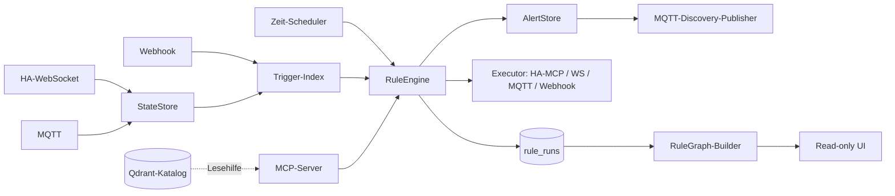

# Architektur smart-bridge

Die Bridge läuft neben Home Assistant (HA). Sie ist im Betrieb HA-unabhängig, nutzt HA aber für Geräte und Integrationen.

## Grundsätze

- Quellen und Senken sind Adapter hinter klaren Interfaces (`Protocol`).
- Die RuleEngine kennt kein HA und kein Netzwerk. Zeit (`Clock`) und Zustand (`StateStore`) sind injiziert.
- YAML in `config/rules/*.yaml` ist die Single Source of Truth. Vektorindex und UI sind abgeleitet.
- Der Katalog ist eine reine Lesehilfe. Regelauswertung und Aktionen hängen nie davon ab.
- HA-Ausfall: Reconnect mit Backoff, letzter Zustand bleibt gültig, Entities werden `stale`. Stale-Wechsel sind keine Zustandsänderung.
- Zeitlogik nur mit tz-aware Datetimes (Standard `Europe/Berlin`).

## Modulstruktur (`src/smart_bridge/`)

| Modul | Aufgabe | Meilenstein |
|---|---|---|
| `settings` | Env-/Secret-Konfiguration | M1 |
| `rules` | Pydantic-Modell, Loader, JSON Schema | M1 |
| `cli` | `bridge validate` | M1 |
| `api` | FastAPI (`/healthz`, `/readyz`, ...) | M1 |
| `state` | StateStore, `stale`-Handling | M2 |
| `adapters` | HA-WS, MQTT | M2 |
| `engine` | Conditions, `for`, `active`, Trigger-Index | M3 |
| `scheduler` | time/cron/date/sun, Missed-Fire | M4 |
| `alerts` | AlertStore, Discovery-Publisher | M5 |
| `executor` | MCP, WS, MQTT, Webhook | M6 |
| `catalog` | Registry-Sync, Embeddings, Qdrant | M8 |
| `mcp_server` | Claude-Schnittstelle | M9/M10 |
| `graph`, `ui_api` | RuleGraph, `/ui` | M11 |

## Datenmodell

### Regel (YAML, Pydantic `Rule`)

| Feld | Typ | Hinweis |
|---|---|---|
| `id` | str | eindeutig, `[a-z0-9_]+` |
| `title`, `intent` | str | `intent` = Nutzerwunsch im Wortlaut |
| `triggers` | list[Trigger] | optional, sonst aus Condition abgeleitet |
| `condition` | Condition | `state`, `numeric_state`, `template`, `time`, `sun`, `workday`, `and`/`or`/`not` |
| `for` | HH:MM:SS | Mindestdauer |
| `active` | `{after, before, weekdays, sun}` | Zeitfenster |
| `per_entity` | list[str] | Alert bzw. Lauf je Entity |
| `mode` | single/restart/queued/parallel | Standard `single` |
| `alert` | `{target, severity, title, message, blink, color, zoom}` | |
| `actions`, `on_activate`, `on_clear` | list[Action] | `repeat_after` optional |
| `on_unavailable` | ignore/deviation | |
| `debounce`, `max_runs_per_hour` | | |
| `created_by` | claude/manual/file | |
| `version`, `locked`, `tags`, `enabled` | | |
| `status` | active/shadow/disabled/error | |
| `tier` | 0/1/2 | berechnet, nicht schreibbar |

### SQLite (`data/bridge.db`)

| Tabelle | Spalten (Auszug) |
|---|---|
| `state_snapshot` | `entity_id` PK, `state`, `attributes` JSON, `last_changed`, `stale` |
| `state_history` | `id`, `entity_id`, `state`, `ts`; Retention Standard 14 Tage |
| `rule_runs` | `run_id` PK, `rule_id`, `trigger` JSON, `condition_trace` JSON, `actions` JSON, `result`, `duration_ms`, `executor`, `started_at` |
| `alert_since` | `alert_id` PK, `since` |
| `snoozes` | `alert_id`, `until` |
| `fire_times` | `rule_id`, `trigger_idx`, `next_fire`, `last_fire` |
| `rule_versions` | `rule_id`, `version`, `file_hash`, `commit`, `author`, `created_at` |
| `audit_log` | `id`, `ts`, `actor`, `action`, `rule_id`, `diff`, `created_by` |
| `approvals` | `rule_id`, `token_hash`, `used_at`, `decision` |

### Qdrant

- `entities`: Payload `entity_id`, `domain`, `area`, `device_id`, `device_class`, `model_target`, `description_hash`, `source`.
- `rules`: Payload `rule_id`, `entity_ids[]`, `target`, `severity`, `file_hash`.

### Alert (Schnittstelle zum 3D-Modell, fest)

`{id, target, severity, title, message, blink?, color?, zoom?, since}`, sortiert nach Severity, dann `since`, maximal 20.

## Laufzeitabläufe

1. Start: Config laden und validieren, Vollsync (`get_states`), Trigger-Index bauen, Scheduler aus persistierten Feuerzeiten (Missed-Fire-Policy) starten, `list_targets` senden.
2. Event: StateStore aktualisieren, Trigger-Index-Lookup, betroffene Regeln auswerten, Alert-Übergang oder Aktionen, `rule_runs` schreiben.
3. Reload: Datei-Hash geändert, Validierungs-Pipeline, bei Fehler letzte gültige Version behalten und Fehler-Alert.

## Sicherheit

- Risikostufe wird aus dem Inhalt bestimmt (`config/policy.yaml`), nie aus dem Pfad.
- `policy.yaml` und `approvals/` sind für Claude/MCP nicht beschreibbar. Stufe-2-Freigabe nur per signiertem Webhook oder CLI.
- `/ui/*` ist ausschließlich `GET`/`HEAD`.
